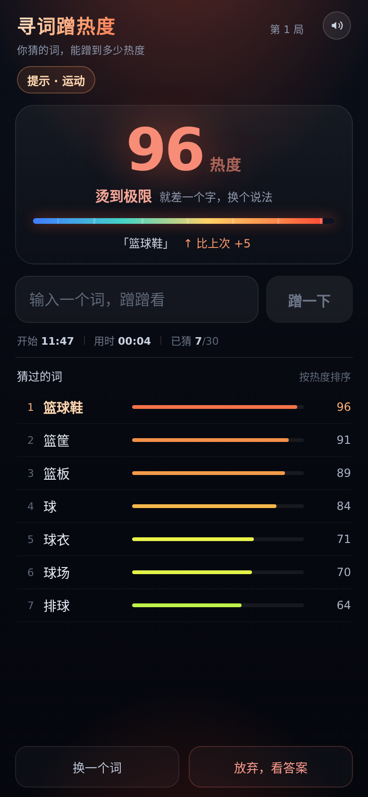

# 寻词蹭热度

核心玩法只有两种：**猜词**（输入任意中文词，服务端用 BGE 词向量算它和目标词的语义关联度，输出 0–100 的**热度**，100 就是答案本身）和**问一句**（向 LLM 判官问是非题，得到「是/否 + 把握度」）。每局 30 次猜词、10 个问题，猜满 10 次才给分类提示。



## 本地跑

```bash
npm install
npm run build                    # 前端产物 dist/
PORT=3110 node server/index.js   # 单端口同时提供静态页和 /api
```

首次启动会从 HuggingFace 拉 `Xenova/bge-small-zh-v1.5`（约 100MB），之后走本地缓存。

## 部署到 Claw

```bash
npm run deploy:claw                          # 默认域名 xunci.grissom.cn
DOMAIN=ciwen.grissom.cn npm run deploy:claw  # 换域名重跑即可
```

`*.grissom.cn` 已泛解析到 Claw，无需手工加 DNS 记录。脚本会构建前端、rsync 到 `/data/ciwen`、装生产依赖并同步 BGE 模型缓存、用 PM2 起 `ciwen`（`127.0.0.1:3110`）、写 Nginx 反代（含 `/ws`）并用 certbot 签发 HTTPS 证书，最后做 HTTP / WebSocket 自检。重复执行是幂等的：`data/`（对局与管理配置）、依赖和证书不会被重建。

看日志：`ssh claw 'pm2 logs ciwen'`。

开发模式：

```bash
node server/index.js      # API :3110
npm run dev               # 前端 :5183，/api 代理到 3110
```

WOA 预览：`https://${GF_IDE_WORKSPACE_ID}-3110.gz.cloudide.woa.com`

## 结构

```
server/embedder.js   模型加载、向量缓存、热度归一化打分
server/words.js      目标词池（20 分类 / 三档难度）
server/judge.js      是非题判官：用 @typesafe-ai/sdk 的 noul 回答"是"的概率
server/index.js      Express：/api/game /api/guess /api/ask /api/reveal + 静态站
src/App.tsx          单屏 UI：玩法切换、焦点反馈、记录列表、结算弹层
src/game.ts          热度档位文案
qa/mobile.mjs        Playwright 多机型布局验证（无滚动/不越界/无报错）
qa/shot.mjs          单机型截图 + 结算层抓图
```

## 热度怎么算

```
热度 = f( cos(guess, target) + 0.1 × 字面重叠 , baseline(target) )
```

- `baseline(target)` = 目标词与 200 个常见参照词的平均余弦，代表"随便猜一个词"的水平
- **字面重叠**：猜的词里含多少个答案的字（按答案字数归一化）。纯余弦只能表达"同一个话题"，分不清「篮球鞋」（包含答案）和「排球」（同类词）；叠这层之后，带答案字的词会明确跳到高位
- 冷区（≤ baseline+0.09）压到 0–8，只保留微梯度；温区 8→100 按 `x^0.62` 拉伸
- 完全相同直接 100；非精确命中最高 99（避免显示 100 却不判胜）

实测一局「篮球」的爬升：

| 猜的词 | 旧 | 新 |
|---|---|---|
| 排球 | 56 | 64 |
| 球场 | 62 | 70 |
| 球 | 78 | 84 |
| 篮板 | 83 | 89 |
| 篮筐 | 85 | 91 |
| 篮球鞋 | 83 | 96 |
| **篮球** | **100** | **100** |

### 为什么加字面重叠

不加之前，同类词（排球/足球/乒乓球）全挤在 56–60，彼此的差值 0.01–0.03 是模型的噪声而非真实距离，玩家只能"在边上绕圈圈"，然后靠枚举撞到答案。换更大的模型并不能解决——实测 bge-base 把「足球」排到「球场」前面，bge-large 更平，baseline 还从 0.36 涨到 0.48，把可用区间挤掉一半。

`tools/linearity.mjs` 可以复现这组对比，`tools/model-compare.mjs` 复现模型对比。

## 热度档位

| 热度 | 说法 |
|---|---|
| 100 | 蹭到了 — 就是这个词 |
| 95–99 | 烫到极限 — 就差一个字 |
| 81–94 | 烧起来了 — 答案就在这条线上 |
| 66–80 | 很烫 — 顺着这个方向往里挖 |
| 51–65 | 有点烫 — 方向对了 |
| 36–50 | 温热 — 蹭到边了 |
| 21–35 | 微热 — 只是远亲 |
| 9–20 | 凉 — 热度还没传过来 |
| 0–8 | 没蹭到 — 一点边都不沾 |

## 词池

`server/words.js`，23 个分类 223 个词（热梗占 10.8%）：

- 常规 22 类：动物 / 食物 / 饮品 / 植物 / 自然 / 地点 / 职业 / 身体 / 衣物 / 家居 / 科技 / 交通 / 运动 / 音乐 / 影视 / 情绪 / 抽象 / 学科 / 节日 / 工具 / 天气 / 商业
- **热梗**（2025–2026 网络热词，24 个）：打工人、躺平、社恐、邪修、班味、搭子、嘴替、活人感、松弛感、边界感、主理人、电子榨菜、具身智能、酱板鸭、丝瓜汤、爱你老己、夯爆了、大抽象、敬自己一杯、向上社交、赛博对账、苏超、从从容容、背手负鼠

### 热梗入选标准（重要）

热词能不能当答案，取决于**词向量模型认不认识它**——模型不认识，玩家怎么猜都只有 0–8 热度，这局就是废的。

验证方法：拿 2–3 个语义上应该相关的普通词去猜它，看能不能蹭到热度。

```bash
node tools/hotword-check.mjs   # 逐词打印最高热度 + 淘汰名单
```

- 入选要求：至少一个相关普通词能蹭到 **≥30 热度**
- 被淘汰的 11 个：内卷(8) 摸鱼(26) 破防(26) 情绪价值(27) 数字游民(27) 谷子(6) 显眼包(7) 牛马(7) 凡尔赛(7) 养龙虾(5) 数字泔水(8)

换模型（比如更大的 bge-base-zh）后这批词值得重测，大模型对 2025+ 的新词覆盖更好。

## 界面元素

前端按两种玩法组织，一屏只留最有用的信息：

- 顶栏：品牌、**还剩几次猜词**、音效开关
- 玩法切换：**猜词**（看 0–100 热度）/ **问一句**（判官答是/否 + 把握度，每局 10 问）
- 焦点卡：只显示当前玩法最近一次的结果（热度数字与档位 / 是或否），下面一条进度；服务端解锁的分类与字数提示收成一行淡字
- 记录区：只有一个列表，跟着玩法切换——猜词按热度排序（词 + 热度条 + 数值），问句按时间倒序（问题 + 是/否 + 把握度）
- 输入区：一个输入框 + 提交按钮；底部「换一个词 / 看答案」收成一行小字
- 结算层：答案、一句结果说明、再来一局

刻意不显示：在线名单与改名、开局时刻与用时、本地战绩、热度刻度与升降对比、卡关引导语、Top5 轨迹、复制战绩。服务端仍下发 `startedAt` / `endedAt`，前端不再展示计时。

## 音效

全部用 Web Audio API 现场合成（`src/sfx.ts`），不加载任何音频文件，零额外体积：

| 热度段 | 音型 |
|---|---|
| 100 蹭到了 | 大三和弦上行 + 高音闪光 + 噪声火花 |
| 95–99 | 极近的高音三连（方波），带轻微颤音 |
| 81–94 | 659 → 831 → 988 三连上行 |
| 66–80 | 587 → 740 → 880 |
| 51–65 | 523 → 659 |
| 36–50 | 440 → 554 |
| 21–35 | 392 上滑到 466 |
| 9–20 | 330 下滑到 262 |
| 0–8 没蹭到 | 220 + 110 双低频闷响 |

另有三种事件音：`playTap()`（按"蹭一下"的电流声）、`playDup()`（重复猜同一个词）、`playLose()`（机会用尽的下行三音）。结果音在数字滚动落定（380ms）后响，落在"揭晓"那一刻。右上角有静音开关，状态存 localStorage。

## QA

```bash
node qa/mobile.mjs      # 390×844 / 360×640 / 414×896 布局
node qa/sfx-bands.mjs   # 逐段验证 10 个热度档 → 9 种音型
node qa/sfx-tiers.mjs   # 真实对局验证（需 PORT=3111 CIWEN_DEV_HINT=1 的服务）
```

需要 `npx playwright install chromium`。

## 本地调试帮助

`CIWEN_DEV_HINT=1 PORT=3110 node server/index.js` 会让 `/api/game` 返回答案，仅本地用，生产不要设。

### 是非题模式（问一句）

输入区上方切到「问一句」，玩家可以提是非题（如"这是一个面积很大的地方吗？"），判官模型站在答案立场回答"是"的概率（比如 70% 是 / 30% 否），每局限 10 问，问答对全房间同步。判官走 OpenAI 兼容接口，需要配置环境变量：

```bash
TYPESAFE_API_KEY=ts-xxx \
PORT=3110 node server/index.js
```

不配置时是非题会提示未配置，猜词玩法不受影响。
